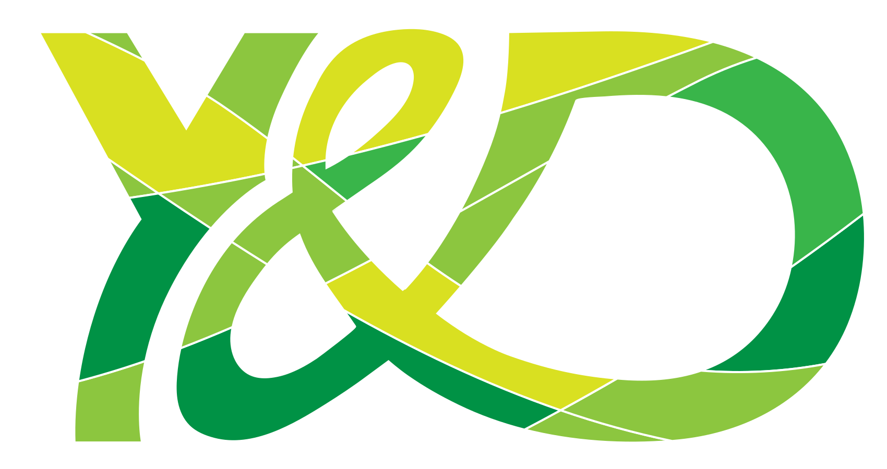

<p align="center">
  
</p>
<h1 align="center">Young And Digital Learning</h1>

<p align="center">
  
</p>

## GitHub Organization Configuration

This repository contains the public GitHub organization profile and shared GitHub configuration for **Young & Digital Learning**, an academic full-stack software project developed as part of the _Programming Lab: Social Networking_ at **Technische Universität Berlin (TU Berlin)** in collaboration with the **Sprach- und Kulturbörse (SKB)**.

**[Explore Interactive Demo](https://younganddigitallearning.github.io/)**

## Organization Profile

The public project overview is maintained in [`profile/README.md`](profile/README.md) and displayed on the [Young & Digital Learning organization page](https://github.com/YoungAndDigitalLearning).

It provides an introduction to the project, its technology stack, architecture, and repositories.

## Project Repositories

| Repository                                                        | Description                                                             |
| ----------------------------------------------------------------- | ----------------------------------------------------------------------- |
| [ydl](https://github.com/YoungAndDigitalLearning/ydl)             | Main repository integrating the frontend and backend as Git submodules. |
| [ydl-front](https://github.com/YoungAndDigitalLearning/ydl-front) | Vue.js frontend built with JavaScript, Bootstrap, and Sass/SCSS.        |
| [ydl-api](https://github.com/YoungAndDigitalLearning/ydl-api)     | Python REST API built with Django REST Framework and MariaDB.           |

## Repository Structure

```text
.github/
├── README.md          # About this configuration repository
└── profile/
    └── README.md      # Public organization profile
```

## Updating the Organization Profile

Edit [`profile/README.md`](profile/README.md) and commit the changes to the repository's default branch. GitHub automatically renders this file on the organization's public profile.

This repository contains documentation and organization-level configuration; the application source code lives in the project repositories linked above.
