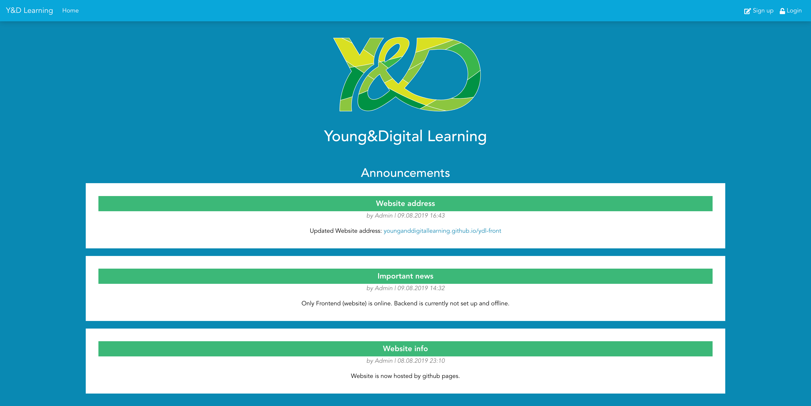
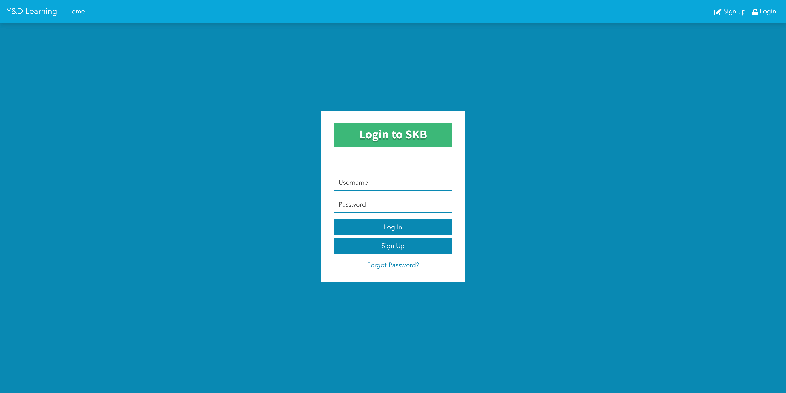
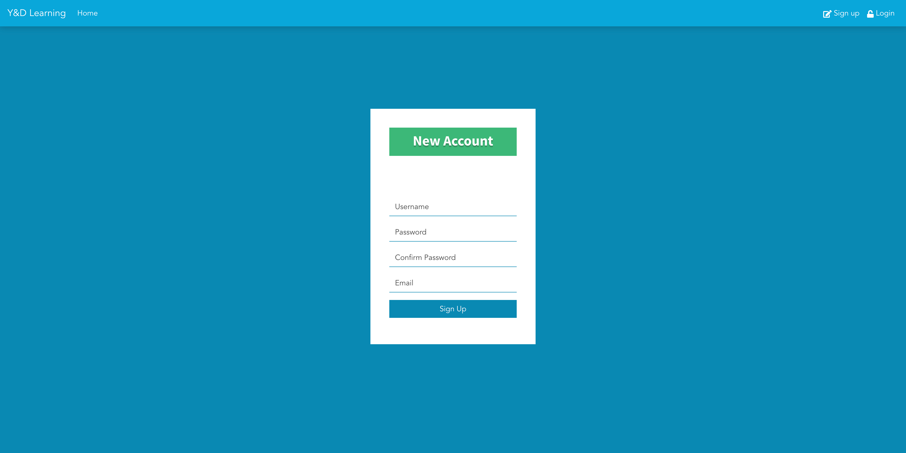

    
    <h1 align="center">Young And Digital Learning</h1>

**A full-stack web application developed at Technische Universität Berlin (TU Berlin) in collaboration with the Sprach- und Kulturbörse (SKB).**

An academic software engineering project combining a modern Vue.js frontend, a RESTful backend, and a self-managed Linux deployment environment.

**[Explore the Frontend](https://github.com/YoungAndDigitalLearning/ydl-front)** · **[View the Full Project](https://github.com/YoungAndDigitalLearning/ydl)** · **[Frontend Preview](https://younganddigitallearning.github.io/ydl-front/)**

## Preview

---

## About the Project

Young & Digital Learning was developed as part of the _Programming Lab: Social Networking_ course at **TU Berlin**, in cooperation with the university's **Sprach- und Kulturbörse (SKB)**.

The project involved designing, developing, and deploying a full-stack web application using a component-based frontend architecture, REST API communication, and persistent relational data storage.

Beyond application development, the project also covered server configuration and deployment on a self-managed Ubuntu system.

## Technology Stack

| Area                 | Technologies                                        |
| -------------------- | --------------------------------------------------- |
| **Frontend**         | Vue.js, JavaScript, Bootstrap, Sass/SCSS, HTML, CSS |
| **Frontend Tooling** | npm                                                 |
| **Backend**          | Python, Django REST Framework, REST APIs            |
| **Database**         | MariaDB                                             |
| **Deployment**       | Linux (Ubuntu), Nginx, Gunicorn                     |
| **Version Control**  | Git, GitHub, Git Submodules                         |

## Application Architecture

The application follows a client-server architecture with a clear separation between the frontend, backend, and database.

**Frontend — Vue.js**

A browser-based user interface built with Vue.js, using Bootstrap and Sass/SCSS for styling and responsive layouts.

↓

**Backend — Django REST Framework**

A Python-based REST API responsible for handling application requests, business logic, and data access.

↓

**Database — MariaDB**

Relational database used for persistent application data storage.

The application was deployed on a self-managed Ubuntu server, with Nginx serving as a web server and reverse proxy and Gunicorn running the Python backend.

## Project Repositories

The project is organized into three Git repositories, with the frontend and backend integrated into the main repository as Git submodules.

### [ydl — Main Project](https://github.com/YoungAndDigitalLearning/ydl)

The main project repository, bringing together the frontend and backend as Git submodules.

### [ydl-front — Frontend](https://github.com/YoungAndDigitalLearning/ydl-front)

The client-side application developed with Vue.js, JavaScript, Bootstrap, and Sass/SCSS.

**Focus:** Component-based UI development, responsive styling, and REST API integration.

### [ydl-api — Backend](https://github.com/YoungAndDigitalLearning/ydl-api)

The server-side application developed with Python and Django REST Framework, backed by MariaDB.

**Focus:** RESTful API endpoints, backend application logic, and persistent data storage.

## Deployment & Infrastructure

The project was deployed in a self-managed Linux environment.

- **Ubuntu** — Server operating system
- **Nginx** — Web server and reverse proxy
- **Gunicorn** — Python application server
- **MariaDB** — Relational database
- **Git & GitHub** — Source control and project organization

This setup provided practical experience with deploying and operating a full-stack application beyond a local development environment.

## Academic Context

**Institution:** Technische Universität Berlin (TU Berlin)

**Course:** Programming Lab: Social Networking (_Programmierpraktikum Soziale Netzwerke_)

**Collaboration:** Sprach- und Kulturbörse der TU Berlin (SKB)

**Project type:** University software engineering project

---

_Young & Digital Learning is presented here as an academic software development project and a technical portfolio reference._
