

  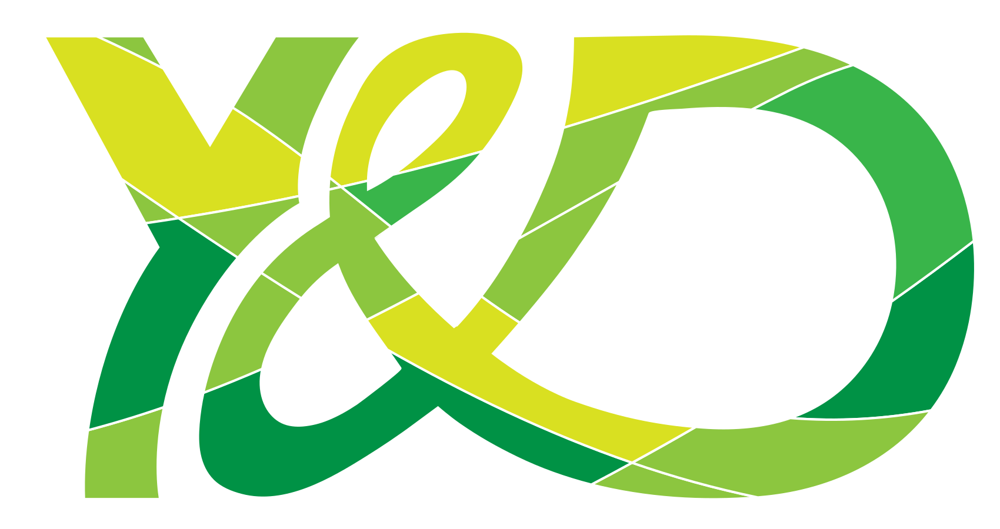

<h1 align="center">Young & Digital Learning</h1>

  <!-- Website Online/Offline -->
  
   
  <!-- Vue.js -->
  
  <!-- Django -->
  
   
  <!-- GitHub License -->
  

**An academic full-stack web application developed at Technische Universität Berlin (TU Berlin) in collaboration with the Sprach- und Kulturbörse (SKB).**

Originally developed as an academic software engineering project, Young & Digital Learning combines a **Vue 2 frontend**, a **Django REST Framework API**, and a **MariaDB database**.

The legacy full-stack application has been restored for local development and demonstration using Docker Compose. An **interactive, backend-free demo is now available on GitHub Pages**, featuring fictional student and teacher accounts, browser-local data persistence, and resettable sample content.

The original REST API is also documented through a publicly accessible, read-only OpenAPI/Swagger reference.

  <a target="_blank" rel="noopener noreferrer" href="https://github.com/YoungAndDigitalLearning/ydl"><strong>Full Project</strong></a> ·
  <a target="_blank" rel="noopener noreferrer" href="https://github.com/YoungAndDigitalLearning/ydl-front"><strong>Frontend</strong></a> ·
  <a target="_blank" rel="noopener noreferrer" href="https://github.com/YoungAndDigitalLearning/ydl-api"><strong>Backend</strong></a> ·
  <a target="_blank" rel="noopener noreferrer" href="https://younganddigitallearning.github.io/"><strong>GitHub Pages</strong></a>

## Application Showcase

The screenshots below show the restored application with **fictional demo accounts and sample content**. They illustrate both the student experience and the course management tools available to teachers.

### Student Experience

#### Landing Page

Project branding, announcements, and entry points for authentication.

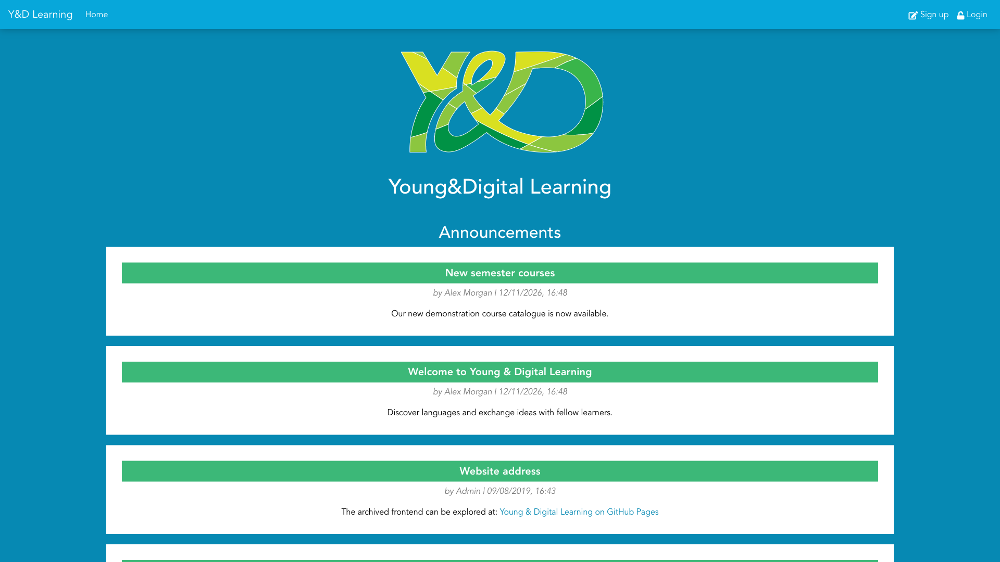

#### Student Dashboard

Overview of enrolled courses, navigation, and upcoming activities.

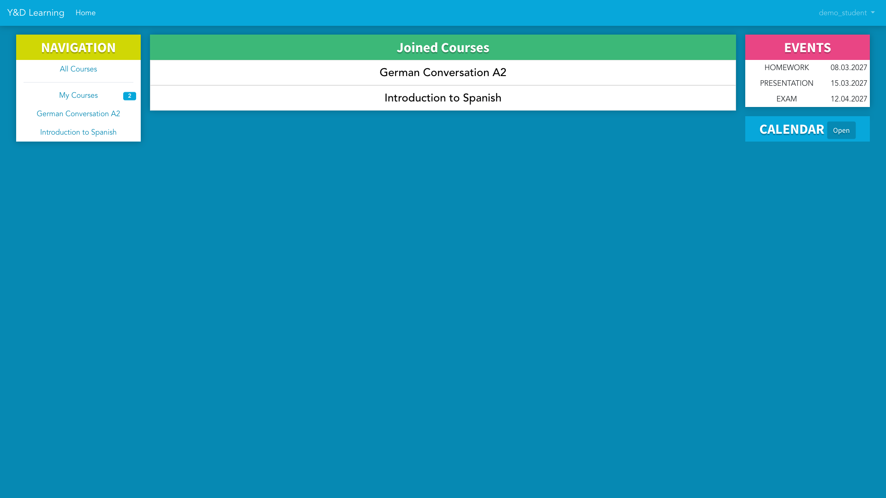

#### Course Discovery and Details

Students can browse available courses, review descriptions, and manage enrollment.

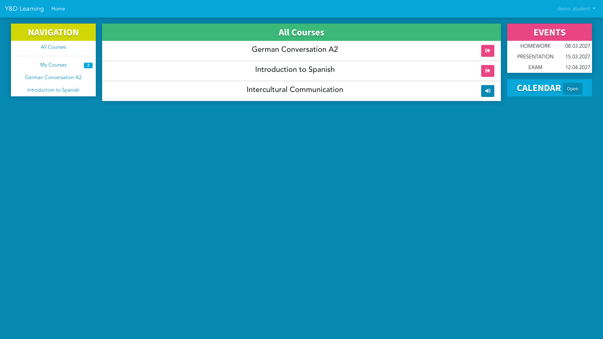

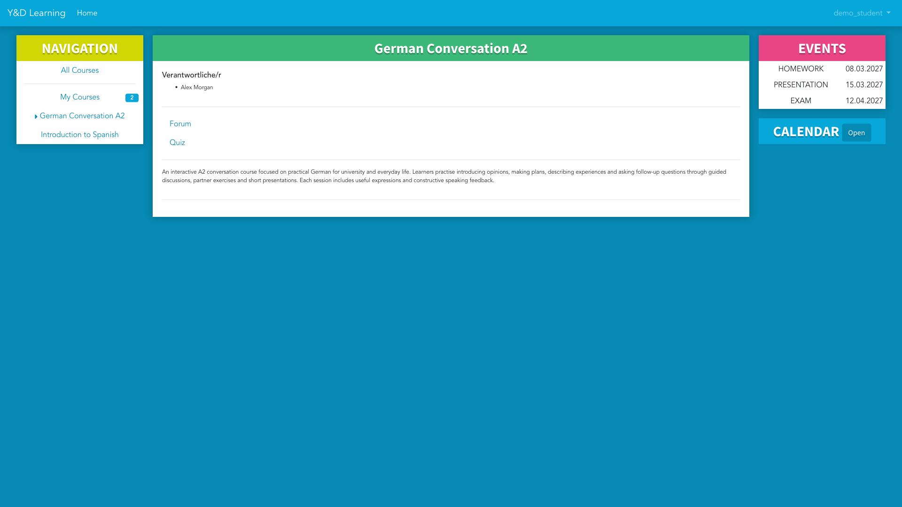

#### Course Forum

Course discussions with dedicated threads and replies.

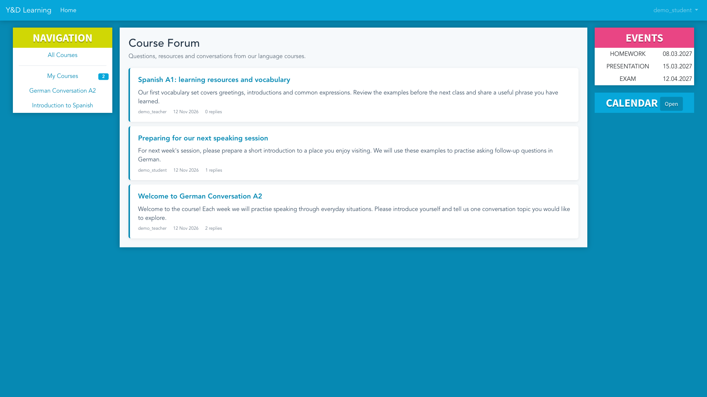

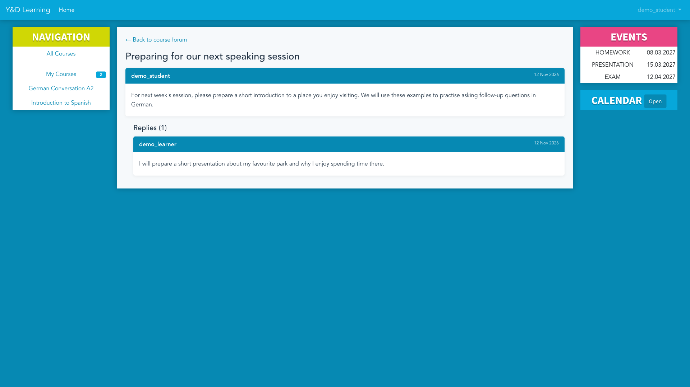

#### Interactive Quiz

An interactive language exercise with immediate **client-side feedback**. The demo result is not stored as a graded assessment.

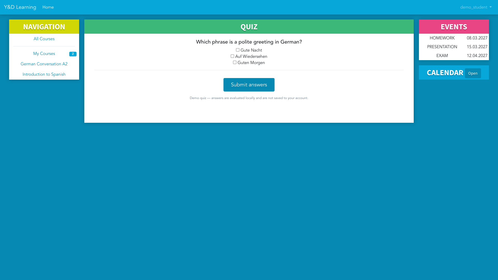

#### Course Calendar

Calendar view for example course assignments and events.

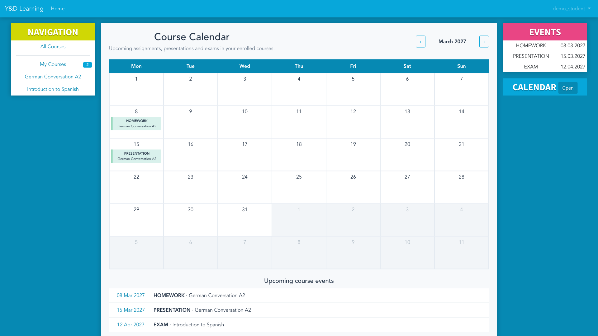

#### Mobile Views

Two narrow-screen captures of the student course page and quiz, at a consistent **430 × 932 px** viewport.

<table align="center">
  <tr>
    <td align="center">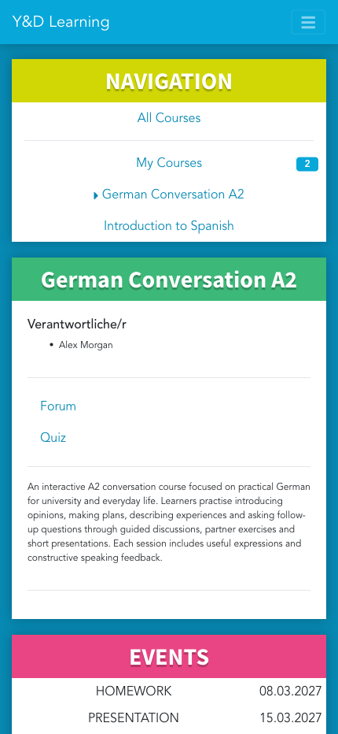</td>
    <td align="center">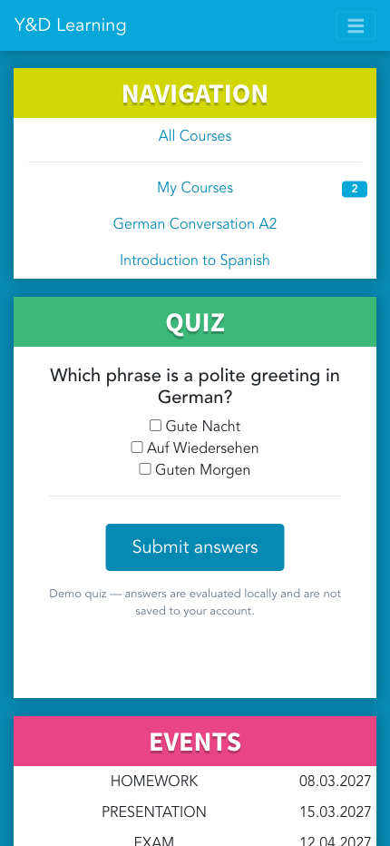</td>
  </tr>
  <tr><td align="center"><em>Course details</em></td><td align="center"><em>Interactive quiz</em></td></tr>
</table>

### Teacher Experience

Teachers can manage their courses, edit course content, configure quizzes, and access forms for creating resources and new courses. The screenshots show the available management interfaces, not a claim that every editing workflow has been production-tested.

#### Teacher Dashboard and Course Overview

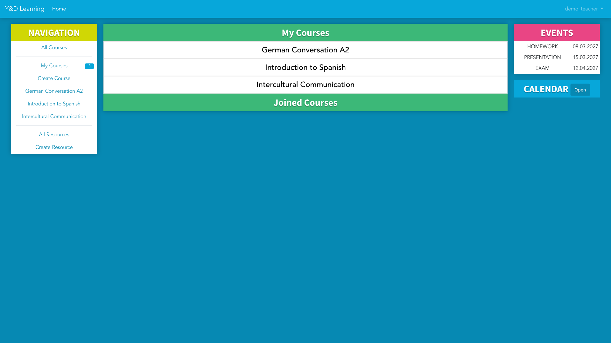

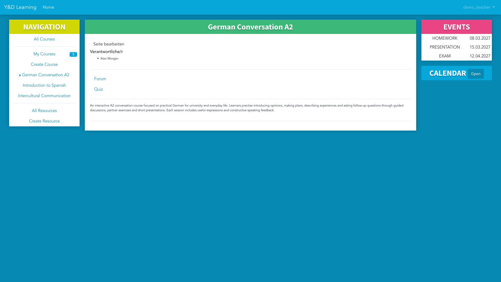

#### Editing a Course and Quiz

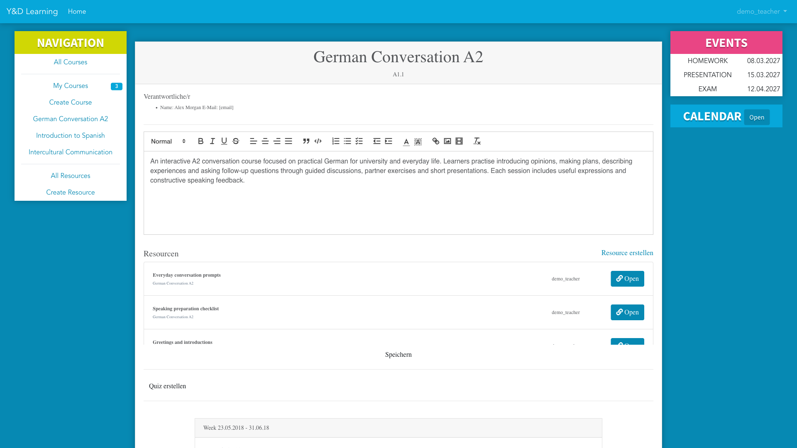

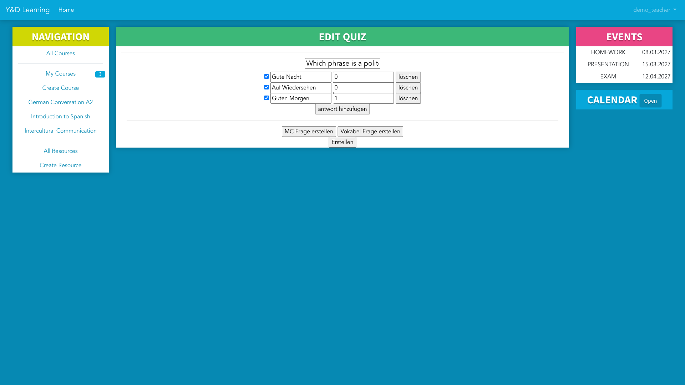

#### Creating Learning Resources and Courses

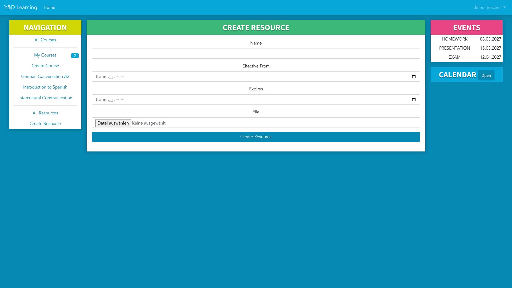

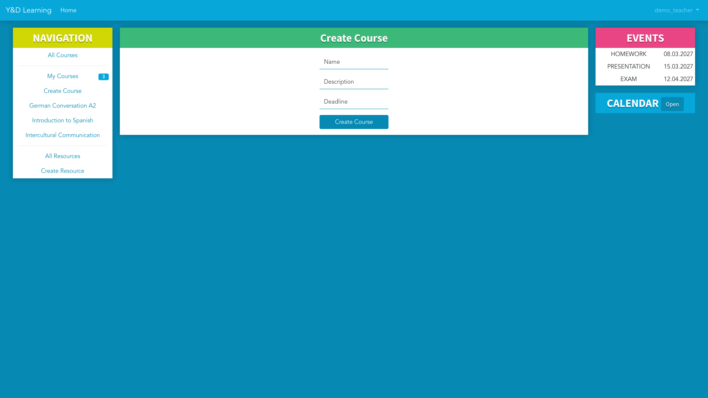

_All screenshots use fictional demonstration data. The historical application is presented as an academic project and a portfolio reference._

---

## About the Project

Young & Digital Learning was developed as part of the _Programming Lab: Social Networking_ course at **TU Berlin**, in cooperation with the university's **Sprach- und Kulturbörse (SKB)**.

The project involved designing, developing, and deploying a full-stack web application using a component-based frontend architecture, REST API communication, and persistent relational data storage.

Beyond application development, the project also covered server configuration and deployment on a self-managed Ubuntu system.

## Technology Stack

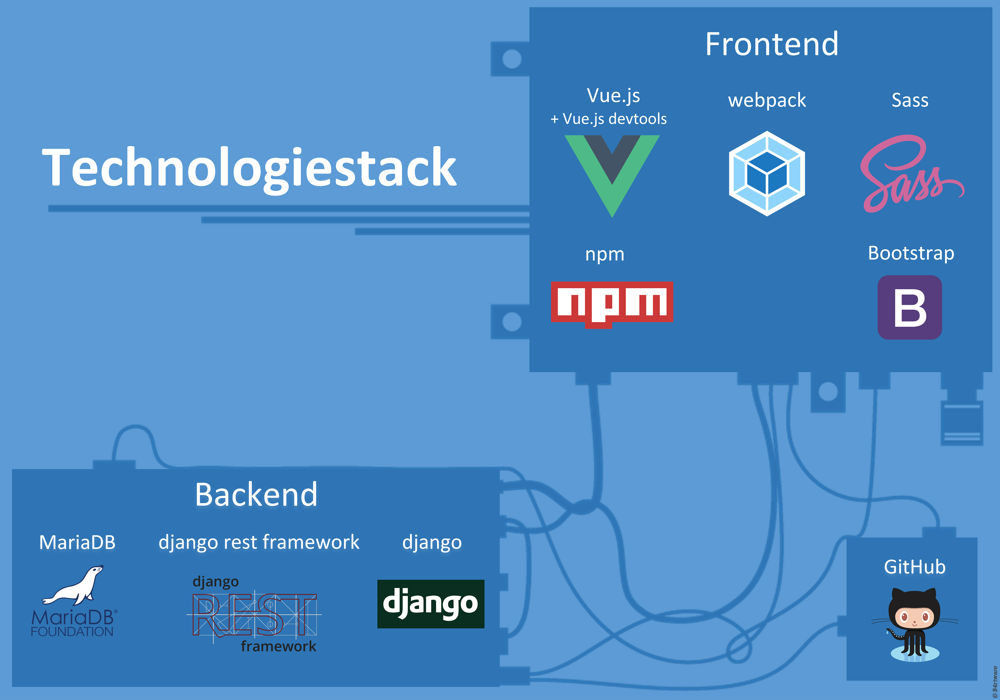

| Area                 | Technologies                                       |
| -------------------- | -------------------------------------------------- |
| **Frontend**         | Vue 2, JavaScript, Bootstrap, Sass/SCSS, HTML, CSS |
| **Frontend Tooling** | Webpack 3, npm (legacy application)                |
| **Backend**          | Python, Django REST Framework, REST APIs           |
| **Database**         | MariaDB                                            |
| **Deployment**       | Linux (Ubuntu), Nginx, Gunicorn                    |
| **Version Control**  | Git, GitHub, Git Submodules                        |

## Application Architecture

The application follows a client-server architecture with a clear separation between the frontend, backend, and database.

---

  <b>Frontend — Vue.js</b>
   
  A browser-based user interface built with Vue.js, using Bootstrap and Sass/SCSS for styling and responsive layouts.
   
  ↓
   
  <b>Backend — Django REST Framework</b>
   
  A Python-based REST API responsible for handling application requests, business logic, and data access.
   
  ↓
   
  <b>Database — MariaDB</b>
   
  Relational database used for persistent application data storage.

The application was deployed on a self-managed Ubuntu server, with Nginx serving as a web server and reverse proxy and Gunicorn running the Python backend.

## REST API Reference

The original Django REST Framework backend exposes the APIs used by the Vue frontend. An archived OpenAPI specification is available as an interactive, **read-only** Swagger UI reference. It documents the original API contract without requiring a running Django server.

  <a href="https://younganddigitallearning.github.io/ydl-api/"><strong>Explore REST API Documentation</strong></a>
  &nbsp;·&nbsp;
  <a href="https://younganddigitallearning.github.io/ydl-api/openapi.json">Download OpenAPI JSON</a>
  &nbsp;·&nbsp;
  <a href="https://github.com/YoungAndDigitalLearning/ydl-api">View Django Backend</a>

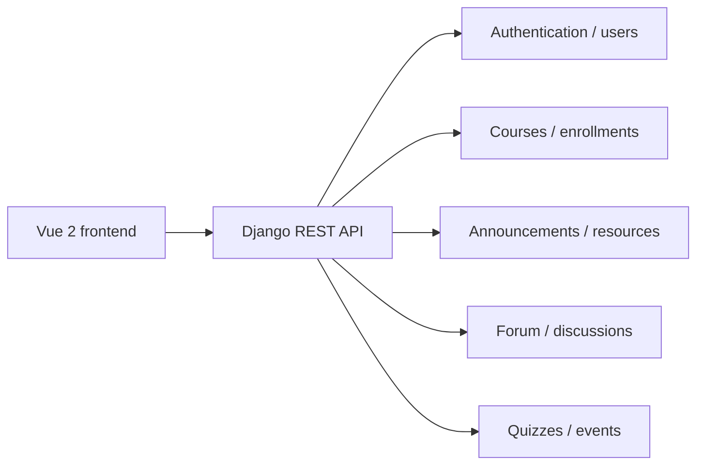

<small>The schema is a snapshot of the historical backend. All live API execution is disabled in this documentation; the public frontend demo uses fictional local data.</small>

## Project Repositories

The application is organized into three Git repositories, with the frontend and backend integrated into the main repository as Git submodules. The organization also maintains a separate GitHub profile repository and a GitHub Pages repository for the planned public demo.

### [ydl — Main Project](https://github.com/YoungAndDigitalLearning/ydl)

The main project repository, bringing together the frontend and backend as Git submodules.

### [ydl-front — Frontend](https://github.com/YoungAndDigitalLearning/ydl-front)

The client-side application developed with Vue.js, JavaScript, Bootstrap, and Sass/SCSS.

**Focus:** Component-based UI development, responsive styling, and REST API integration.

### [ydl-api — Backend](https://github.com/YoungAndDigitalLearning/ydl-api)

The server-side application developed with Python and Django REST Framework, backed by MariaDB.

**Focus:** RESTful API endpoints, backend application logic, and persistent data storage.

## Local Restoration & Portfolio Demo

The original Vue 2 and Django 2 application has been restored locally using Docker Compose with separate frontend, backend, and MariaDB services. Fictional seeded data supports repeatable feature demonstrations and screenshot capture using Playwright. 

## Deployment & Infrastructure

The project was deployed in a self-managed Linux environment.

- **Ubuntu** — Server operating system
- **Nginx** — Web server and reverse proxy
- **Gunicorn** — Python application server
- **MariaDB** — Relational database
- **Git & GitHub** — Source control and project organization

This setup provided practical experience with deploying and operating a full-stack application beyond a local development environment.

## Academic Context

**Institution:** Technische Universität Berlin (TU Berlin)

**Course:** Programming Lab: Social Networking (_Programmierpraktikum Soziale Netzwerke_)

**Collaboration:** Sprach- und Kulturbörse der TU Berlin (SKB)

**Project type:** University software engineering project

---

_Young & Digital Learning is presented here as an academic software development project and a technical portfolio reference._
